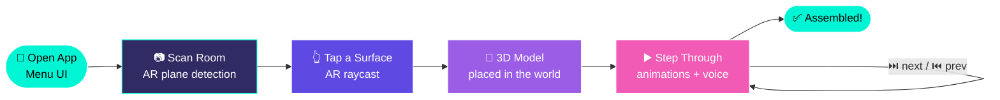

<p align="center">
  
</p>

<p align="center">
  
</p>

<p align="center">
  
  
  
  
  
  
</p>

---

<h2 align="center">📦 ➜ 📱 ➜ 🕶️ THE IDEA</h2>

<p align="center">
Flat paper manuals are hard to follow. This proof-of-concept turns a <b>product assembly manual into an interactive AR experience</b>.<br/>
Point your phone at the floor, <b>place a life-size animated 3D model</b> of the product, and walk through <b>51 assembly steps</b><br/>
with animations, illustrated instructions and <b>voice-over guidance</b>.
</p>

---

<h2 align="center">🔄 HOW IT WORKS</h2>



---

<h2 align="center">🖼️ STEP-BY-STEP CONTENT</h2>

<p align="center">
  
  
  
</p>
<p align="center">
  
  
  
</p>
<p align="center"><sub>51 illustrated steps, synced to the 3D model's animation in AR</sub></p>

---

<p align="center">
  
</p>

---

<h2 align="center">🧠 UNDER THE HOOD</h2>

| Script | Role |
|:--|:--|
| `PlaceOnPlane.cs` | 🎯 Touch → `ARRaycastManager` raycast → spawn or move the model on a detected plane |
| `AnimationController.cs` | 🎬 Plays the model's assembly animation for the current step |
| `AnimEvents.cs` | ⏱️ Animation events that sync visuals, UI and audio |
| `ImageManager.cs` | 🖼️ Swaps the illustrated instruction for each step |
| `Pagination.cs` / `NumBUtton.cs` | 📑 Step navigation and numbered jump buttons |
| `ToggleButton.cs` | 🔘 Show / hide UI panels |
| `LookAt_camera.cs` | 👀 Billboard behaviour for world-space UI |

**Scenes:** `Menu_UI` → `BlankAR`

---

<h2 align="center">🚀 RUN IT</h2>

```bash
git clone https://github.com/vishwaMoger/weber_AR.git
```

1. Open the folder in **Unity 2022.3 LTS**.
2. Switch the platform to **Android** (ARCore) or **iOS** (ARKit) in *Build Settings*.
3. Add `Menu_UI` and `BlankAR` to the build, then **Build & Run** on an AR-capable device.

---

<p align="center">
  <b>Made with ❤️ and 🕶️ by <a href="https://github.com/vishwaMoger">Vishwa Moger</a></b><br/>
  <sub>Game Developer · 3+ years · Bangalore, India</sub>
</p>


